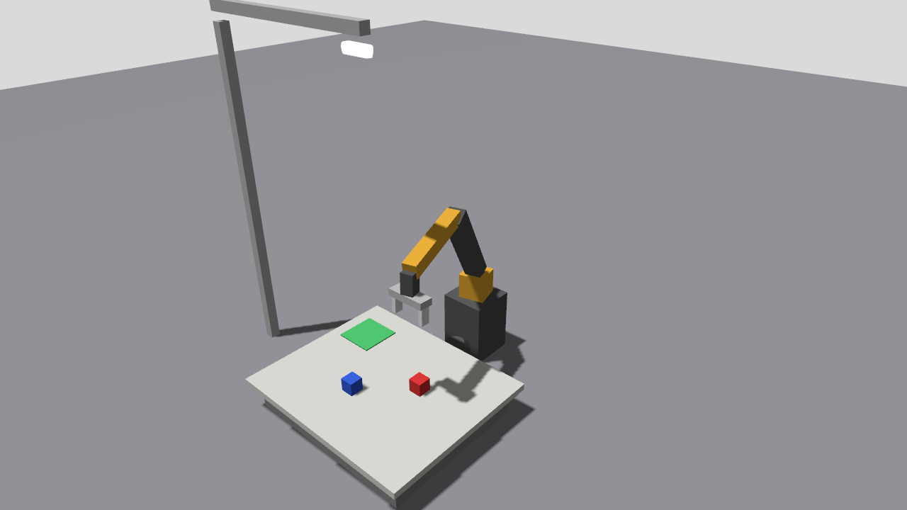

# ROS 2 Workshop Code

Everything you type, run, and change during the three-day ROS 2 Jazzy workshop, from
the first Linux command to a robot arm that finds a box with a camera and places it in a tray.

Slides: <https://runtimerobotics.github.io/ros2_workshop_slides/>



## What is inside

| Folder or package | Day | What you learn |
|---|---|---|
| [`setup/`](setup) | before | install ROS 2 Jazzy (or Lyrical), check the machine is ready |
| [`00_linux_basics/`](00_linux_basics) | prerequisites | terminal commands and shell scripts |
| [`01_python_basics/`](01_python_basics) | prerequisites | the Python a ROS node uses: classes and callbacks |
| [`02_cpp_cmake_basics/`](02_cpp_cmake_basics) | prerequisites | C++ with CMake: a program, a library, a test |
| [`demo_interfaces`](ros2_ws/src/demo_interfaces) | 1 | custom message, service, and action |
| [`demo_py`](ros2_ws/src/demo_py) | 1 | topics, services, actions, parameters, timers, executors in Python |
| [`demo_cpp`](ros2_ws/src/demo_cpp) | 1 | the same in C++, built with CMake |
| [`demo_turtlesim`](ros2_ws/src/demo_turtlesim) | 1 | drive, draw, spawn, rotate, and recolour turtles from Python |
| [`demo_launch`](ros2_ws/src/demo_launch) | 1 | launch files in Python, XML, and YAML |
| [`demo_tf2`](ros2_ws/src/demo_tf2) | 2 | static and moving frames, lookups, a turtle that follows another |
| [`demo_arm_description`](ros2_ws/src/demo_arm_description) | 2 | URDF/Xacro of a 5-joint arm with a gripper and sensors |
| [`demo_arm_gazebo`](ros2_ws/src/demo_arm_gazebo) | 2 | Gazebo world, RealSense, lidar, IMU, force-torque, contact sensors |
| [`demo_arm_control`](ros2_ws/src/demo_arm_control) | 3 | ros2_control controllers, trajectories without a planner |
| [`demo_arm_moveit`](ros2_ws/src/demo_arm_moveit) | 3 | MoveIt 2: planning, IK, straight-line moves, 3D vision |
| [`demo_arm_vision`](ros2_ws/src/demo_arm_vision) | 3 | find coloured boxes with OpenCV, pick and place with MoveItPy |
| [`labs/`](labs) | all | one page per lab: goal, commands, what "done" looks like |

## The robot: `demo_arm`

An RRBot-style arm: box links in RRBot's orange and black, five revolute joints
(base yaw, shoulder, elbow, wrist pitch, wrist roll) and a two-jaw gripper, about 0.7 m reach.

| Sensor | Where | ROS topic |
|---|---|---|
| Intel RealSense D435 (RGB-D) | on a stand, looking down at the table | `/camera/camera/color/image_raw`, `/camera/camera/aligned_depth_to_color/image_raw`, `/camera/camera/depth/color/points` |
| 2D lidar | front of the pedestal | `/scan` |
| IMU | gripper palm | `/imu` |
| Force-torque | wrist roll joint | `/wrist_ft` |
| Contact | both fingers | `/left_finger/contact`, `/right_finger/contact` |
| Joint encoders | every joint | `/joint_states` |

The camera topics use the same names as the real `realsense2_camera` driver, so the
vision code also runs on a real D435 (`ros2 launch realsense2_camera rs_launch.py align_depth.enable:=true`).

## Setup

Ubuntu 24.04, then:

```bash
git clone https://github.com/runtimerobotics/ros2_workshop_code.git
cd ros2_workshop_code
bash setup/install_jazzy.sh          # ROS 2 Jazzy, Gazebo, ros2_control, MoveIt, OpenCV
bash setup/check_setup.sh            # every line should start with ✓

cd ros2_ws
rosdep install --from-paths src -y --ignore-src
colcon build --symlink-install
source install/setup.bash            # in every new terminal, or add it to ~/.bashrc
```

No Ubuntu 24.04? Use the container in [`docker/`](docker).

## Quick start

```bash
# Day 1: two nodes talking
ros2 run demo_py talker
ros2 run demo_cpp listener                         # second terminal: Python → C++

# Day 1: one command, a configured system
ros2 launch demo_turtlesim turtlesim_demo.launch.py demo:=draw_square

# Day 2: the arm in RViz, then in Gazebo with its sensors
ros2 launch demo_arm_description display.launch.py
ros2 launch demo_arm_gazebo sim.launch.py rviz:=true

# Day 3: MoveIt without a simulator, then the full pick and place
ros2 launch demo_arm_moveit demo.launch.py
ros2 launch demo_arm_vision pick_place_demo.launch.py
ros2 launch demo_arm_vision pick_place_demo.launch.py use_vision:=false   # fixed box poses
```

## How pick and place works

```
RealSense colour + depth ──▶ object_detector ──▶ /detections/red, /detections/blue (poses in world)
                                   │ OpenCV: HSV threshold → largest blob → depth at its centre
                                   │ → back-project with the camera intrinsics → TF to world
RealSense point cloud ──▶ move_group occupancy map (OctoMap): unknown obstacles are avoided
pick_and_place (MoveItPy):
   home → open → pre-grasp (OMPL) → straight down (Pilz LIN) → attach + close
   → straight up → over the tray → straight down → detach + open → straight up → home
```

In Gazebo, a box is locked to the palm while it is held (`DetachableJoint`), because
friction grasps of small boxes slip in simulation; MoveIt attaches it in its planning scene
at the same moment. With `use_vision:=false` the boxes come from `config/params.yaml`.

## Tests

```bash
cd ros2_ws
colcon test && colcon test-result --verbose
```

Every Python package runs flake8 and pep257; `demo_py`, `demo_turtlesim`, and
`demo_arm_vision` have unit tests for their plain functions; `demo_arm_description` checks
that every variant of the URDF expands. CI builds and tests everything on each push.

## Licence

Apache-2.0. The RealSense model comes from Intel's
[`realsense2_description`](https://github.com/IntelRealSense/realsense-ros) (Apache-2.0).
The arm's look follows RRBot from [`ros2_control_demos`](https://github.com/ros-controls/ros2_control_demos).
